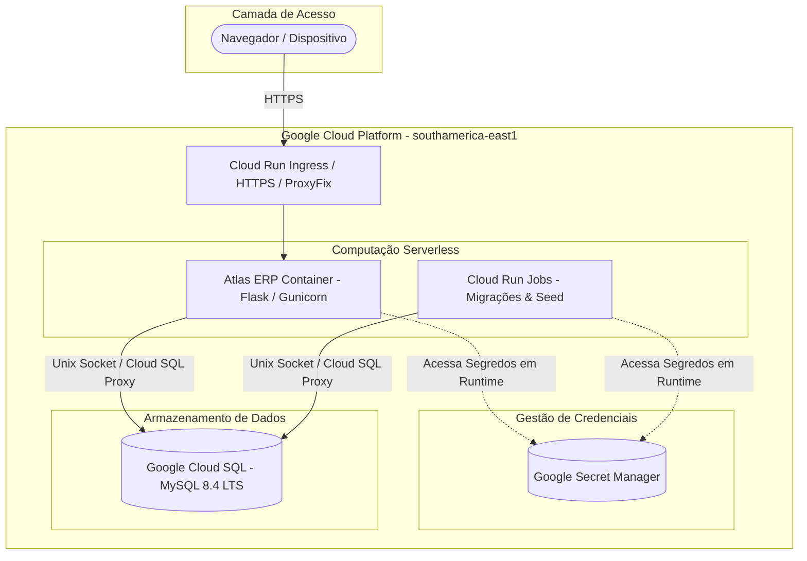

# 🌐 Atlas ERP — Enterprise Cloud Platform

[](https://www.python.org/)
[](https://flask.palletsprojects.com/)
[](https://www.sqlalchemy.org/)
[](https://www.mysql.com/)
[](https://cloud.google.com/)
[-blueviolet?logo=google-cloud&logoColor=white)](https://cloud.google.com/run)
[](https://owasp.org/)
[](https://docs.pytest.org/)

Sistema ERP (*Enterprise Resource Planning*) modular, seguro e altamente escalável para operações de atacado, varejo e distribuição. Projetado com padrões de arquitetura de alta maturidade, segurança em camadas (DevSecOps), controle de acesso baseado em funções (RBAC), trilha de auditoria imutável e infraestrutura em nuvem no **Google Cloud Platform (GCP)**.

---

## 📌 Demonstração em Produção (Live Demo)

- 🔗 **Ambiente de Produção (Cloud Run):** [https://atlas-erp-534057493749.southamerica-east1.run.app](https://atlas-erp-534057493749.southamerica-east1.run.app)
- 📍 **Região:** `southamerica-east1` (São Paulo, Brasil)
- 🔑 **Acesso Demonstrativo:** Credenciais de demonstração disponíveis sob consulta ou via provisionamento de papéis (*Roles*).

---

## 🏗️ Arquitetura do Sistema



---

## 🛡️ Segurança Empresarial & DevSecOps

O Atlas ERP implementa um modelo de **Segurança em Profundidade (*Defense in Depth*)**:

### 1. RBAC Granular (Role-Based Access Control)
- **Papéis Implementados:** `ADMIN`, `GERENTE`, `VENDEDOR`, `ESTOQUISTA`, `FINANCEIRO`, `CONSULTA`.
- Matriz granular com mais de 20 permissões individuais distribuídas por módulos.
- Decorators de proteção em rotas backend (`@permission_required`, `@role_required`, `@financial_required`).
- Bloqueio automático contra ataques de força bruta com bloqueio temporal e contadores de tentativas.

### 2. Trilha de Auditoria Imutável (Double-Layer Interceptor)
- Registro cronológico e detalhado de todas as ações sensíveis (usuário, IP, data/hora UTC, entidade alterada, payload de mudanças em JSON).
- **Camada 1 (ORM):** Listeners SQLAlchemy `before_update` e `before_delete` interceptando comandos no nível de objetos.
- **Camada 2 (Engine):** Interceptor no nível de cursor do banco de dados (`before_cursor_execute`), bloqueando e rejeitando qualquer comando DML direto (`UPDATE` ou `DELETE`) disparado contra a tabela `audit_logs`, impedindo adulterações mesmo via SQL Injection ou scripts acidentais.

### 3. Hardening de Sessão e Transporte
- Sessões protegidas com cookies assinados, `HTTPOnly`, `SameSite=Lax` e `Secure`.
- Compatibilidade nativa com Proxy Reverso (`ProxyFix(x_for=1, x_proto=1)`) garantindo captura correta do IP real do cliente.
- Desativação em produção da conta emergencial genérica (*Break-Glass*), exigindo usuários individuais autenticados.

---

## 📦 Módulos Funcionais do ERP

| Módulo | Principais Recursos |
| :--- | :--- |
| **Painel de Controle (Dashboard)** | Visão 360° com faturamento consolidado, capital imobilizado em estoque, despesas, alertas de estoque baixo e rotas em andamento. |
| **Vendas & Pedidos** | Ciclo completo de vendas (Aberto, Confirmado, Cancelado), cálculo dinâmico de totais e integração automática com baixa de estoque. |
| **Notas Fiscais (NF-e SEFAZ)** | Módulo de faturamento eletrônico com geração de chave de acesso de 44 dígitos, simulação de comunicação SEFAZ e emissão. |
| **Compras & Suprimentos** | Gestão de ordens de compra, homologação de fornecedores e entrada automática de mercadorias no almoxarifado. |
| **Estoque & Almoxarifado** | Extrato de movimentações (*IN/OUT*), controle de estoque mínimo e alertas preventivos contra rupturas. |
| **Clientes & Fornecedores** | Cadastro corporativo com **validação algorítmica matemática** de dígitos verificadores de CPF e CNPJ e formatação de telefones. |
| **Gestão Financeira (DRE)** | Demonstrativo de Resultados do Exercício em tempo real, contas a pagar e a receber, custos fixos vs. variáveis e conciliação. |
| **Folha de Pagamento** | Gestão de colaboradores com salário base, encargos trabalhistas, benefícios e controle de liquidação. |
| **Frotas & Logística** | Cadastro de veículos comerciais e pesados, motoristas qualificados (CNH B, C, D e E), agendamento de rotas e manutenções preventivas. |
| **Logística Reversa (Devoluções)** | Gestão de ocorrências de entrega (cliente ausente, avaria, endereço incorreto) com opção de retorno automático da mercadoria ao estoque. |

---

## 📊 Volume de Dados de Demonstração (Seed Data)

Para validação de performance e demonstração corporativa, o sistema conta com um gerador inteligente de dados fictícios de grande escala:

- **500 Clientes:** 250 Empresas (B2B) e 250 Pessoas Físicas (B2C) com **CPFs e CNPJs matematicamente válidos** e e-mails únicos.
- **30 Veículos de Frota:** Mix operacional de utilitários, furgões, vans e caminhões pesados.
- **25 Motoristas Profissionais:** Com CNHs, validades e contatos.
- **25 Rotas de Entrega pelo Brasil:** Com 15 rotas ativas em andamento simultâneo.
- **15 Fornecedores Homologados:** Com CNPJs válidos e dados completos.
- **20 Produtos no Catálogo:** Com preços, margens e variações de estoque.
- **60 Pedidos de Venda:** Com itens detalhados e notas fiscais emitidas.
- **10 Funcionários:** Com folha salarial e encargos sociais.

---

## 🛠️ Tecnologias Utilizadas

- **Linguagem & Backend:** Python 3.11+, Flask 3.0, Werkzeug, Jinja2
- **Banco de Dados & ORM:** MySQL 8.4 LTS (Produção no Cloud SQL), SQLite (Desenvolvimento local), SQLAlchemy 2.0, Flask-Migrate (Alembic)
- **Infraestrutura em Nuvem:** Google Cloud Platform (Cloud Run, Cloud SQL, Secret Manager, Cloud Build, Artifact Registry)
- **Conteinerização:** Docker, Dockerfile multi-stage, Linux Alpine/Distroless
- **Qualidade & Testes:** pytest (162 testes automatizados de unidade, integração e APIs)
- **Frontend:** HTML5, CSS3 moderno com tema escuro (Dark Mode corporativo), SVG Icons, Vanilla JavaScript nativo e responsivo.

---

## 🧪 Suíte de Testes Automatizados

O projeto mantém uma rigorosa suíte de testes cobrindo regras de negócio, cálculos tributários/financeiros, restrições de integridade e segurança:

```bash
# Executa toda a suíte de testes (162 testes)
pytest -v
```

```text
tests/test_app.py ......................... [ 15%]
tests/test_auth_and_security.py ........... [ 22%]
tests/test_customer.py .................... [ 35%]
tests/test_financial_api.py ............... [ 48%]
tests/test_fleet_returns_api.py ........... [ 55%]
tests/test_product.py ..................... [ 68%]
tests/test_purchase_combined_filters.py ... [ 75%]
tests/test_rbac_and_audit.py .............. [ 88%]
tests/test_stock_movement.py .............. [100%]

======================== 162 passed in 3.82s ========================
```

---

## 💻 Execução Local

### Pré-requisitos
- Python 3.11 ou superior
- Git

### 1. Clonar o repositório
```bash
git clone https://github.com/nandacarat-tech/AtlasERP.git
cd AtlasERP
```

### 2. Criar e ativar o ambiente virtual
```bash
# Windows
python -m venv .venv
.\.venv\Scripts\Activate.ps1

# Linux / macOS
python3 -m venv .venv
source .venv/bin/activate
```

### 3. Instalar dependências
```bash
pip install -r requirements.txt
```

### 4. Executar as migrações e popular o banco
```bash
flask db upgrade
python seed_db.py
```

### 5. Iniciar o servidor
```bash
python run.py
```
Acesse: `http://localhost:5000`

---

## 📄 Licença e Autoria

Desenvolvido por **Fernanda Santos (NandaTech)** como projeto de portfólio de Engenharia de Software, Arquitetura Cloud e Segurança da Informação.
